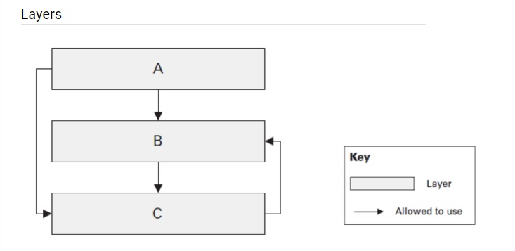

# Name examples of the layered architecture. Do they differ or just extend each other?

There are several examples of the layered architecture:
- Onion Architecture
- Hexagonal Architecture (aka Ports and Adapters Architecture)
- Clean Architecture

They all are in fact exemplify evolutionary development of the idea of the Layered Architecture. What is different is the code organization and
dependency orientation: the three architectures above are domain-centric and embrace the idea of Dependency Inversion Principle, making the core domain models and
business logic completely independent from any other layers.

I would say that the architectures are not different, they extend and supersede each other in a way:
- Hexagonal architecture outlines the overall structure which would protect the core (external part vs. internal with ports/adapters on the boundaries)
- Onion architecture elaborates on the layered structure of the application core (domain model, domain services, architectural services)
- Clean architecture is a standardized summarized variant of Hexagonal and Onion architectures, popularized by Uncle Bob

# Is the below layered architecture correct and why? Is it possible from C to use B? from A to use C?

According to the canonical definition of the layered architecture, a layer can only depend on another layer which is lower in the hierarchy. So C -> B dependency violates the principles of the Layered Architecture and introduces a circular dependency flaw.

On the other hand, A -> C dependency is permitted in the Layered Architecture, if we treat layer B as open. Such a laxation is acceptable when the layer above the open one uses the layer below naturally. However, this decision should be weighted and cautious as it violates level isolation.

# Is DDD a type of layered architecture? What is Anemic model? Is it really an antipattern?

Domain-Driven Development shouldn't be called a type of layered architecture, it is rather a software design philosophy, not a structural architecture.
DDD provides building blocks for the buisiness logic and guidelines how to organize the core of the application, and it isn't focused on concrete layers and dependency orientation concerns.

Anemic Model (anti-)pattern is a way to build domain model so that the state resides in a plain object, and the logic associated is placed somewhere else (typically, in a separate service). Proponents of OOP claim that this pattern is a direct violation of Encapsulation (keeping data and logic as close as possible), so it's in fact an anti-pattern. However, Anemic Model is widely used in modern frameworks, e.g., entities in ORMs, DTOs, plain CRUD objects. Generally, it depends on the complexity of the solution whether you should avoid the pattern; if the domain is simple, it is more pragmatic to embrace the Anemic Model pattern.

# What are architectural anti-patterns? Discuss at least three, think of any on your current or previous projects.

Architectural anti-patterns are well-established solutions to existing software development problems which are highly discouraged for use by industry experts and practitioners due to the ramifications they introduce, e.g., increased complexity, poor extensibility, tight coupling etc.

One of the most famous anti-patterns is Big Ball of Mud. It's a very likely result of neglecting best practices and patterns during development. Such type of codebase has low cohesion, high coupling, it's very hard to maintain, test, understand.

In case of Layered Architecture, quite often there are signs of so called Lasagna Architecture anti-pattern present. This is a result of pedantic rather than pragmatic following the principles of Layered Architecture, i.e., the rule that a layer must directly depend ONLY on the layer right below it. This anti-pattern often leads to multitude of proxy-objects or services which exist solely to propagate data or calls between layers.

Thirdly, there is Golden Hammer anti-pattern, which presume unjustified use of some technology (often over-hyped) just because it is popular or works in some other case. This approach may lead to overengineering, when a simple solution is neglected and a mass of unnecessary structure is added.

# What do Testability, Extensibility and Scalability NFRs mean. How would you ensure you reached them? Does Clean Architecture cover these NFRs?

A system is testable if it's functionality and codebase favors extensiv creation of different kinds of tests (unit, integration, end-to-end). You may ensure this quality if the system is modular, it isn't tightly coupled and its cohesion is high (following SOLID design principles is generally advised). 

Extensibility stands for a quality of a system which easily accepts new feature addition: old code stays intact; ideally, only new code is added (see Open-Closed Principle). It is ensured by using same best practices (patterns, SOLID, etc.), developing a plug-in extension system, favoring configuration over hard-coding.

Scalable solution is ready for an influx of inbound requests or data. It is easily scaled out (horizontally) or up (vertically), responding to demand without significant interruptions and slow-downs. Usually, stateless applications are considered ideal for scaling; architectural choice is also important (see Microservices or Serverless style). Additionally, load balancers may be used to regulate the request rate.

Thanks to the Dependency Inversion Principle, Clean Architecture is built with testability in mind: dependencies go strictly down, services can be easily mocked. In addition, since the Open-Closed Principle is also baked into the architecture, adding new funcionality (extending) to the system is straighforward and facilitated by design. However, scalability isn't directly incorporated into the approach BUT it is made highly simpler to implement because of high cohesion and modularity promoted, what makes the solution Microservices- or Serverless-ready.